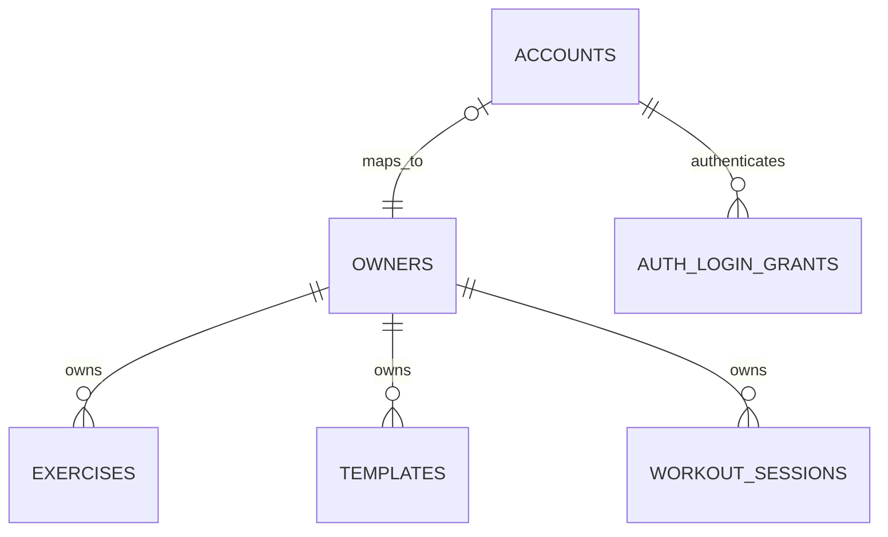

# Proposal: Google sign-in and private accounts

**Status: proposed, awaiting owner review.** Design for [#88](https://github.com/agersk0v/crow-fitness/issues/88), under [#87](https://github.com/agersk0v/crow-fitness/issues/87). Nothing in this document is implemented configuration, a migration to run, or permission to expose the existing app publicly. Merging this design records agreement only if the owner explicitly approves its decisions; implementation and release are separate work.

## Recommendation and decisions for review

Use **Go-owned Google OpenID Connect sign-in and opaque application sessions stored in PostgreSQL**. Next.js serves the UI and forwards credentials; Go verifies them and selects the internal owner. Keep the existing workout tables and owner IDs.

| Decision | Recommended first version |
| --- | --- |
| Authentication libraries | `coreos/go-oidc/v3/oidc` + `golang.org/x/oauth2`; SCS v2 with its pgx PostgreSQL store for application sessions |
| Callback and credential authority | Go, reached through the same public Next.js origin |
| Account identity | Internal account ID, unique Google subject, unique association to an existing/new owner ID |
| Session | Random opaque cookie; PostgreSQL-backed SCS state plus a revocable login grant |
| Session duration | 7-day absolute lifetime, 24-hour idle timeout; fresh Google login required afterward |
| Existing data | Unclaimed until an operator explicitly binds a recently verified account to its owner; no first-login takeover |
| Old local-only mode | Replace it when authentication ships; no unauthenticated fallback in the new release |
| Deployment | One public HTTPS origin; only Next.js exposed; Go and PostgreSQL private |

These are recommendations to approve together in the PR. The owner still needs to choose the production hostname, supply a Google OAuth web client during implementation, and identify the intended Google account for the later data-claim procedure. No credentials or Google subject should be posted in this PR. There are no alternative session architectures left for an implementer to choose silently.

## Current repository and alternatives

Inspected base: `df011f5` (main, including Exercises pagination). [README](../../README.md), [PRODUCT](../PRODUCT.md), and [ARCHITECTURE](../ARCHITECTURE.md) describe the current single-user behavior. `backend/internal/exercises/exercises.go` selects `LocalOwnerID = 1`; template/session/history handlers also select that owner. Stores already accept owner IDs and composite foreign keys protect many relationships. Migration 006 preserves `workout_sessions` and enforces one unfinished workout per owner. `owners.id` currently has no default allocator.

`frontend/app/api/[...path]/route.ts` forwards allowlisted JSON APIs and preserves status/Location, but does **not** forward session cookies, CSRF headers, or Set-Cookie. Its fetch follows redirects by default. `backend/cmd/api/main.go` registers feature handlers without authentication, and the pgx pool currently has four connections. Compose publishes only Next.js on localhost; authentication cannot be achieved by adding a login page alone. No auth packages exist in the current manifests.

| Option | Fit and operational tradeoff | Decision |
| --- | --- | --- |
| Go OIDC + OAuth2 + SCS/pgxstore | Mature OIDC/OAuth clients, stable server-session library, existing `net/http`/pgx stack. Go alone owns identity and DB access. Requires application integration, CSRF, and claim logic; not a turnkey account product. Libraries are Apache-2.0, BSD-3-Clause, and MIT respectively; no library subscription. We operate PostgreSQL and patch dependencies. | Recommend |
| Better Auth in Next.js | MIT TypeScript auth framework with broader account features for future passwords/providers. Would move auth persistence into Node or require an integration layer, and Go still needs a documented verification/introspection boundary. Adds a second runtime owning authentication data. | Viable, but more integration for this Go-owned application |
| Auth.js in Next.js | Existing OAuth/session ecosystem (ISC). Its current README recommends Better Auth for new projects. Does not remove the Go authorization/session integration problem. | Do not start a new integration here |

The reviewed upstream documentation is linked below. No packages were installed or tested for compatibility in this design task. During implementation, pin supported releases, check current security advisories and Go runtime requirements, and verify the selected pgxstore version supports pgx v5 and a configurable table name. Do not adopt a moving branch as a production dependency. Future native passwords/passkeys require another design review; these libraries do not supply their complete account-recovery flows.

## Request flow and trust boundary

```mermaid
sequenceDiagram
    participant B as Browser
    participant N as Next.js public origin
    participant G as Go API
    participant P as PostgreSQL
    participant O as Google
    B->>N: GET /api/auth/csrf
    N->>G: Anonymous session request
    G->>P: Save anonymous session and CSRF token
    G-->>B: CSRF token and session cookie, through Next
    B->>N: POST /api/auth/google/start (CSRF-protected form)
    N->>G: Allowlisted cookie, Origin, form body
    G->>P: Store short-lived login attempt
    G-->>B: 303 to Google, through Next
    B->>O: Choose Google account
    O-->>B: Redirect with code and state
    B->>N: GET /api/auth/google/callback
    N->>G: Code, state and browser session cookie
    G->>P: Atomically consume browser-bound attempt
    G->>O: Exchange code with PKCE; verify ID token
    G->>P: Resolve/create account; create login grant; renew session
    G-->>B: Set-Cookie and 303 to local route, through Next
    B->>N: GET/POST private /api resource
    N->>G: Session cookie and CSRF header for writes
    G->>P: Validate session/grant/account; select owner-scoped data
    G-->>B: Private uncached response, through Next
```

Proposed routes (not available today):

| Route | Contract |
| --- | --- |
| `GET /api/auth/csrf` | Return synchronizer token for the current anonymous/authenticated session; never cached |
| `POST /api/auth/google/start` | CSRF-protected browser form; create attempt and redirect with 303 |
| `GET /api/auth/google/callback` | Public OIDC callback; its state/nonce/browser binding replaces ordinary write-CSRF validation |
| `GET /api/auth/me` | Valid session required; minimal account/profile information and freshly resolved owner; 401 otherwise |
| `POST /api/auth/logout` | CSRF-protected revocation of this login grant and cookie deletion; safe repeated logout |
| `/login` | Public Next.js login UI and generic callback failure/retry feedback |
| `/account` | Private page showing account information, including verified identity for the operator claim procedure |

All other application pages require sign-in. Private APIs return 401 for missing/invalid/expired credentials and use non-disclosing 404 responses for missing/foreign resource IDs. A database/session-store outage returns a generic 503, never a fallback to owner 1. Public `/api/health` and `/api/ready` retain liveness/readiness behavior, without session-store writes; unknown routes remain 404. Public assets and the login page do not require identity.

The Go auth middleware loads the SCS session, checks its login grant and account record on **every** private request, and installs an internal principal in request context. Handlers pass only that principal's resolved owner to stores. Browser `owner_id`, `X-User-ID`, `X-Owner-ID`, Authorization values, and proxy identity assertions are not alternative authentication methods. Direct calls to Go use the same middleware; network privacy is additional protection, not authorization.

Next.js must explicitly forward only the application session cookie, original Origin, required content type, and `X-CSRF-Token` for allowlisted endpoints. Strip untrusted identity/forwarded headers; never manufacture an owner header. It must use `redirect: manual` upstream so Google redirects reach the browser, pass each Set-Cookie separately without comma-joining, preserve auth Location/status and appropriate response content types, and support the login form's URL-encoded body. Avoid forwarding Google authorization codes to unrelated paths. Go constructs callbacks/redirects from configured `PUBLIC_ORIGIN`, never incoming Host or X-Forwarded-Host.

Next page guards may call `/api/auth/me` server-side while forwarding the same cookie with `cache: no-store`; they must not independently decode or invent identity. Cookie renewal is relayed only through writable route responses; read-only rendering checks cannot silently lose required Set-Cookie updates. Data authorization always happens in Go. No Google or application bearer token is stored in localStorage.

## Google protocol details

Use authorization code flow, S256 PKCE, random state and nonce, and scopes `openid email profile`. Do not request offline access or unrelated Google scopes. Go uses discovery from the fixed Google issuer and a configured web-client ID/secret; neither issuer nor endpoints can come from request parameters.

A login attempt expires in five minutes and contains a hash of random state, a binding to the initiating anonymous session, nonce, PKCE verifier, and a validated local return path. Store attempts in PostgreSQL so a callback can hit any replica. At callback, validate parameters/browser binding and atomically consume exactly one nonexpired attempt before exchanging the code. Missing, repeated, expired, wrong-browser, or replayed state fails with no account/session creation. Failures require starting a new attempt. Concurrent attempts use separate state rows; a completed login invalidates other attempts for that anonymous session.

Verify Google's ID-token signature using `go-oidc` and cached Google public keys, issuer, intended audience, expiry and nonce; enforce Google's authorized-party (`azp`) rules when relevant. Normalize only Google's documented equivalent issuer spellings to `https://accounts.google.com`; never relax issuer/audience verification generally. Require a nonempty subject. Inspect profile claims separately and treat unverified email as unverified metadata. An email change updates profile metadata, not account identity.

The **Google ID token** establishes identity at callback only. The exchanged Google access token is not a Crow Fitness credential; discard access/ID tokens after validation and profile extraction, and do not retain refresh tokens. The **application session cookie** is an independent random bearer credential for Crow Fitness. No general-purpose JWT API access token is introduced in this release.

Only permit return paths under known local application routes. Reject absolute URLs, scheme-relative paths, backslashes, control characters, and auth/logout loops. On denial, missing code, provider outage, or token-verification failure, show a generic login error with Retry; do not expose raw tokens/errors in URLs or logs. Use account selection for explicit account switching and a new anonymous login state; never silently link a new Google identity to the old account.

## Sessions, revocation, and CSRF

Use SCS v2 with the pgxstore configured to a dedicated `auth_session_store` table. Random session tokens are generated/renewed by the library. No signed JWT session, session signing key, Redis service, sticky sessions, or in-memory production store is needed. Protect the database and backups as credentials-bearing data; never log cookies, codes, state, nonce, PKCE verifiers, or stored session data.

| Setting | Proposed value/behavior |
| --- | --- |
| Production cookie | `__Host-crow_session`; HttpOnly; Secure; SameSite=Lax; Path=/; no Domain |
| Local HTTP cookie | `crow_session_dev`; HttpOnly; SameSite=Lax; Path=/; no Domain; only explicit loopback development |
| Authenticated expiry | 7 days absolute from login, 24 hours idle; cookie never outlives grant's absolute expiry |
| Anonymous login state | 10-minute session lifetime; attempts expire after 5 minutes; never promotes itself to an owner |
| Renewal | SCS idle expiry updates; never extend the grant's absolute deadline; renew the session token at successful login |
| Logout | Revoke the login grant in PostgreSQL, destroy SCS state, expire cookie, then navigate to login; other devices remain signed in |
| Global invalidation | Increment account `auth_version`; all grants carrying older versions fail immediately on subsequent checks |

Configure anonymous/authenticated session handling explicitly rather than assuming SCS defaults provide both lifetimes. Authenticated sessions contain only account ID, login-grant ID, version and CSRF state. The owner is resolved from the current account row, not cached permanently in the cookie. The grant's revocation/expiry/version checks remain mandatory even if an old concurrent response recreates SCS store data after logout. Expired/revoked credentials never become authenticated again through automatic renewal. A late Set-Cookie can cause another 401, but must not restore access.

Logout prevents requests authorized after revocation; it cannot undo a write already authorized and running. For privileged owner reassignment/recovery, quiesce application traffic as described below. Monitor session-store load: this adds database reads/writes to a pool currently limited to four connections; measure and size pools per replica within the PostgreSQL connection budget before increasing replicas. Expiry cleanup is bounded and may run on multiple replicas; expired rows are rejected even before cleanup. Keep revoked grants until their absolute expiry so late requests cannot revive them. PostgreSQL state survives restarts; a restored backup requires truncating auth sessions/attempts and invalidating grants before reopening access.

Use a random synchronizer CSRF token bound to the server-side session. All cookie-authenticated POST/PUT/DELETE operations, including login start/logout, require both an exact `Origin` match to `PUBLIC_ORIGIN` and a matching token (header for JSON writes; hidden field for the browser login form). Reject missing/null/cross-origin Origin rather than falling back to arbitrary forwarded hosts. Rotate CSRF state at authentication changes. GET is read-only except bounded anonymous-session/attempt housekeeping; callback is protected by its one-use login protocol. Do not enable credentialed cross-origin CORS. SameSite cookies supplement these checks rather than replace them.

After successful logout or a 401, abort outstanding private fetches, discard page/list/chart/reference data and drafts that must not cross accounts, notify other tabs through BroadcastChannel (or a storage event), and perform a full navigation to `/login`. Tabs revalidate identity on focus and before accepting resumed private results. Key outstanding UI work by account/session generation; stale responses from the previous account cannot repopulate the new view. All private API and server-rendered responses are `Cache-Control: private, no-store`; exclude them from service-worker/CDN caching. Mark authenticated Next routes dynamic and avoid shared data caches. Browser back navigation must revalidate before revealing private content.

Google signing-key rotation is handled through OIDC discovery/JWKS refresh with bounded network deadlines. An unknown key/outage fails the login, not verification. Rotating the Google client secret affects new exchanges; coordinate rollout across replicas and expire outstanding login attempts, while existing Crow sessions can remain valid. There is no application signing key to rotate in the opaque-cookie design. An application-session compromise requires revoking the relevant grant or account version; a broader compromise requires global session invalidation and credential rotation.

## Minimal proposed schema and ownership

This is a conceptual migration contract, **not executable SQL**. Use a new numbered migration; never modify applied migrations.



| Record | Fields and constraints |
| --- | --- |
| Existing `owners` | Retain all IDs/rows. Add a database sequence/default for future IDs, initialized above the locked current maximum; never allocate `max(id)+1` in application requests. Existing unclaimed owners can have no account. |
| New `accounts` | Generated internal bigint `id`; unique nonnull `owner_id` FK; unique nonblank `google_sub`; nullable email/display name and email-verification metadata; `auth_version` bigint; creation/last-Google-login timestamps. No unique email constraint. |
| `auth_session_store` | SCS/pgxstore schema: token primary key, serialized data, expiry; expiry index. Do not reuse `workout_sessions` or rename workout tables. |
| `auth_login_grants` | Random grant ID, account FK, account version, login/absolute-expiry timestamps, nullable revocation timestamp; account and expiry indexes. SCS references the grant; a grant ID alone is not accepted as a credential. |
| `auth_login_attempts` | Hashed state primary key, anonymous-session binding, nonce, PKCE verifier, validated local return path and expiry; expiry index; atomic consume. Treat contents as short-lived secrets. |
| `auth_owner_claim_audit` | Append-only operator event: account, prior/new owner IDs, time, and operator reason/identity; never raw login credentials. No public write endpoint. |

Account ID and owner ID are both internal decimal-string JSON identities. The account is the login/profile entity; the owner remains the data partition. They need not have the same numeric value. Keep the unique owner association: one account has one owner and an owner has at most one account. The optional account end of the diagram allows legacy unclaimed owners to remain valid.

First login resolves the verified Google subject in a transaction. For a new subject allocate a new owner and account together. The unique subject constraint arbitrates concurrent callbacks: roll back the losing transaction (including its owner insertion), then read the winning account. Create a fresh login grant only after account resolution; never seed/copy another owner's exercise library. Existing subject sign-in updates profile metadata without changing owner. Account failure cannot produce an authenticated session.

Workout tables and composite foreign keys remain unchanged. Keep migration 006's partial unique index for one active workout per owner, which becomes one per account. Audit every handler, including exercises/pagination/usage, templates/defaults/alternatives/copy/archive/restore, session selection/sets/order/end actions, history details/filters/options/progress, references and dev reset. Remove runtime fixed-owner fallbacks; store APIs continue receiving trusted owner IDs. Do not infer privacy merely from an unguessable resource ID.

Later, a new `login_identities(account_id, issuer, subject)` table can receive the existing Google mapping with a unique `(issuer, subject)` constraint. Other verified sign-in methods would attach explicitly to the same account. That migration must preserve account IDs, owners, grants, and workout rows; email must never automatically merge identities. Password/passkey recovery and linking are separate scope.

## Explicit existing-data claim and recovery

Recommend a **future operator-only CLI**, with dry-run and explicit confirmation, not an HTTP endpoint. No claim tool or command exists yet. Do not run SQL from this proposal or bind an identity during this PR.

1. Before upgrading an existing database, take a backup and rehearse restore in an isolated database. Record owner IDs and counts/IDs of exercises, templates, workouts, sets and active sessions. Keep ingress private/maintenance-only throughout rollout.
2. Run the additive migrations and the complete authenticated release. Owner 1 and its history remain unclaimed. Sign in privately using the intended Google account, verifying the selected account in Google's UI. This creates a separate, empty account/owner initially.
3. The private `/account` page shows the internal account ID and canonical Google issuer/subject from the server's verified identity. The operator compares those exact values to the CLI's DB lookup and confirms the intended person through the controlled login. Require a recent successful Google login (within five minutes) before binding. Email/display name is informational only; possession of an email address alone is insufficient evidence.
4. Put all replicas in maintenance, stop/drain application traffic and workers, and run the CLI dry-run against the intended database. Lock the account and both owner rows. Require an unclaimed target owner, expected current account mapping, exact verified subject, and a completely empty source owner across **all** owned tables (including archived templates, active/completed sessions, sets/tombstones). Any content or conflicting mapping aborts; merging datasets is separate work.
5. With explicit confirmation, in one transaction change only `accounts.owner_id` to the target, increment `auth_version`, revoke the account's grants, and append a claim audit row. Keep the old empty owner row unclaimed; do not delete it or rewrite workout foreign keys. On retry, the exact already-completed binding reports success without another move; mismatched expectations fail.
6. Compare preserved IDs/counts and active-session state, resume traffic, and require a fresh login to see the existing data. A fresh install follows ordinary new-account creation and needs no claim. Do not automatically claim an empty seeded owner 1 either.

For a mistaken binding, keep traffic quiesced, inspect the audit event and both datasets, revoke affected sessions/increment versions, and restore the mistaken account's previous empty-owner mapping transactionally. Bind the rightful recently verified account through the same checked procedure. Require explicit expected mappings and recheck that returning to the prior owner does not conceal or merge new data. Do not automatically transfer the mistaken account's Google subject or delete its account. If the error allowed data to be read, revocation cannot undo disclosure. If data changed while wrongly accessible, stop and plan recovery from the backup/audit with operator review; never blindly restore an entire live database or discard other users' newer workouts.

Application/schema rollback means keeping maintenance/private access, retaining additive tables and a tested backup, and fixing forward where possible. Never expose the old unauthenticated binary publicly as a rollback shortcut. A pre-auth release can only be used again in the former private local environment after verifying schema compatibility and understanding any newer data; full restore is a separate reviewed operation.

## Configuration and deployment contract

All names below are **proposed**, not settings supported by today's code. Only public origin information belongs in frontend configuration; credentials remain in Go/server secrets.

| Setting | Responsibility and example |
| --- | --- |
| `PUBLIC_ORIGIN` | Required exact external origin, e.g. `https://fitness.example.com`; Go builds callback as `/api/auth/google/callback`; Next uses the same value |
| `GOOGLE_CLIENT_ID` | Google OAuth web-client identifier, configured server-side |
| `GOOGLE_CLIENT_SECRET` | Secret available only to Go through deployment secret injection; never `NEXT_PUBLIC_*` |
| `APP_ENV` | Explicit `production` or `development`; unknown value fails startup; production requires HTTPS and disabled reset |
| Existing `API_INTERNAL_URL` | Private Next-to-Go address; fixed by deployment, never supplied by requests |
| Existing `DB_*` / `POSTGRES_PASSWORD` | Existing server DB configuration; same persistent database holds accounts/sessions; restrict network access and backups |
| Existing `ENABLE_DEV_RESET` | Must be false in production; startup rejects true there; in development requires an authenticated owner and existing confirmation header |

No `AUTH_DISABLED` switch or implicit owner-1 fallback is retained in the authenticated release. Missing Google credentials/origin, incompatible schema, or session-store failure blocks authenticated service rather than enabling local mode. For local development, explicitly use a loopback HTTP origin (choose `localhost` or `127.0.0.1` consistently), its exact registered Google redirect URI, a separate development OAuth client, and the development cookie. Local automated tests use an injected test OIDC issuer only in test code; production issuer is fixed to Google.

The production hostname, Google consent-screen audience/testing status, and redirect URI must be configured before release. Google verification/publication requirements and any service limits must be checked for the actual client configuration then; this design does not promise approval or a provider service-level agreement. No extra paid identity service is selected. We still own hosting, patching, monitoring, backups, and any Google policy obligations.

TLS terminates at the trusted ingress, which routes the same origin to Next.js. Keep Go/DB private; no wildcard CORS or callback URI. Preserve Secure cookies even when Next-to-Go is internal HTTP; trust only the configured public origin. Use HTTPS/private encrypted transport on internal hops if they leave a trusted network. Scale Go/Next replicas against shared PostgreSQL without sticky sessions; use bounded auth endpoint rate limits at ingress/application, including callbacks, and database timeouts. Check liveness without session creation; readiness checks required DB/schema availability, while a Google outage is a login dependency failure rather than a reason to kill pods or log existing users out.

## Follow-up work and release gate

After owner review, scope these tasks under #87 without creating them in this design PR:

1. **Authentication/session implementation:** additive schema, Google flow, SCS/grants/CSRF, forwarding, login/account UI, logout/cache clearing, and failure handling. Depends on approval here. Keep staging private.
2. **Complete ownership enforcement:** replace every fixed owner, guard all private routes, verify two-account isolation, preserve workout rules. May be developed alongside task 1 after its principal contract is fixed. Authentication alone must not be deployed publicly.
3. **Deployment and migration:** operator claim tool/audit, backup/restore rehearsal, real Google test-client flow, secrets/callback/ingress configuration and smoke-test adaptation. Depends on both implementations; test direct Go access as well as the Next proxy.

Release only after all three pass their verification, the intended account has claimed existing data if desired, and no unauthenticated application path remains. Deploy additive migrations with ingress restricted; do not mix old unauthenticated and new authenticated pods under public traffic. Update PRODUCT/ARCHITECTURE/README around shipped contracts at implementation time, retaining this proposal as decision context rather than claiming it is current behavior.

## Verification plan for implementation

| Area | Required evidence on disposable data |
| --- | --- |
| Google/OIDC | Real test-client browser login/cancel/retry/sign-out; fake-provider tests for wrong signature/issuer/audience/nonce/azp, expired tokens, state replay/wrong browser, return-URL injection, PKCE mismatch, and provider/key-refresh outages |
| Session/CSRF | Cookie flags and multiple Set-Cookie forwarding; JSON and login-form CSRF; missing/null/wrong Origin; fixation resistance, expiry/renewal, per-device logout with concurrent late commits, account-version invalidation and DB outage failures |
| Replica/restart | Begin login on replica A, callback on B, private request on C; DB persistence across restart; absolute expiry not extended; no sticky-session assumption; bounded cleanup and connection load |
| Accounts | Concurrent callbacks yield one account/owner per subject; same email/different subject stay separate; changed email preserves identity; valid unknown/foreign IDs do not leak data |
| Isolation | Two accounts exercise every read/write/reference/history/filter/chart/page/count endpoint through Next and directly through Go, including forged headers, cross-owner UUID/ID writes, caches, and per-owner active-session conflicts |
| Migration/claim | Existing populated owner remains inaccessible to first login; ordinary fresh install; recent verified identity requirement, empty source, conflicting claims, idempotent retry, wrong-binding recovery, unchanged workout IDs/snapshots/values and backup restore |
| Browser/data | Logout/account switching across tabs, outstanding responses, Back/Forward and restored pages, drafts, dialogs, and sign-in after expiry; no stale private content becomes visible to another account |
| Deployment | HTTPS/callback/origin validation, disabled production reset, secret absence from frontend/assets/logs, external Go/DB unavailable, public probes work, and authenticated smoke flow using a disposable project |

Run the existing relevant frontend format/type/build and Go formatting/vet/race checks during implementation. Adapt the representative smoke flow to obtain test sessions without shipping a production bypass; use a test-only harness/provider and disposable database. This documentation PR requires accuracy/link/diff review, not application test runs or a live Google client.

## Sources and implementation references

The GitHub READMEs, licenses and pgxstore implementation below were inspected on 2026-11-01. These links are references, not pinned production versions. The Google provider documentation is an additional implementation reference:

- [Go OIDC README](https://github.com/coreos/go-oidc/blob/v3/README.md) and [Apache-2.0 license](https://github.com/coreos/go-oidc/blob/v3/LICENSE): provider discovery and ID-token verification layered on OAuth2.
- [Go OAuth2](https://github.com/golang/oauth2) and [BSD license](https://github.com/golang/oauth2/blob/master/LICENSE): authorization-code client; use its PKCE support in implementation.
- [SCS README](https://github.com/alexedwards/scs/blob/master/README.md) and [MIT license](https://github.com/alexedwards/scs/blob/master/LICENSE): stable maintenance status, token renewal, idle/absolute timeouts and PostgreSQL stores.
- [SCS pgxstore README](https://github.com/alexedwards/scs/blob/master/pgxstore/README.md) and [implementation](https://github.com/alexedwards/scs/blob/master/pgxstore/pgxstore.go): pgx v5, store schema, configurable table name and expiry cleanup. Grant revocation and claim behavior above are application requirements, not promised SCS features.
- [Better Auth README](https://github.com/better-auth/better-auth/blob/main/README.md): TypeScript auth framework, MIT license.
- [Auth.js README](https://github.com/nextauthjs/next-auth/blob/main/README.md): feature set, ISC license and recommendation for new projects to consider Better Auth.
- [Google OpenID Connect documentation](https://developers.google.com/identity/openid-connect/openid-connect): provider-specific requirements to recheck during implementation.
